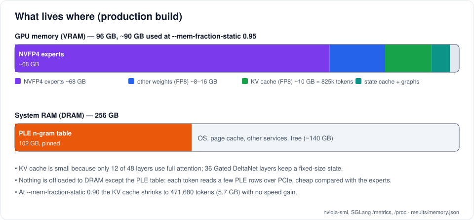
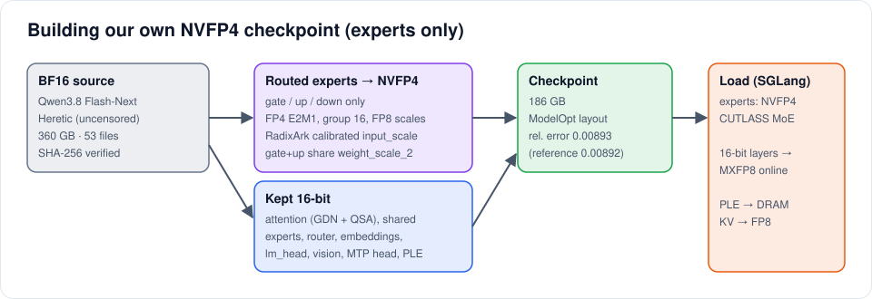
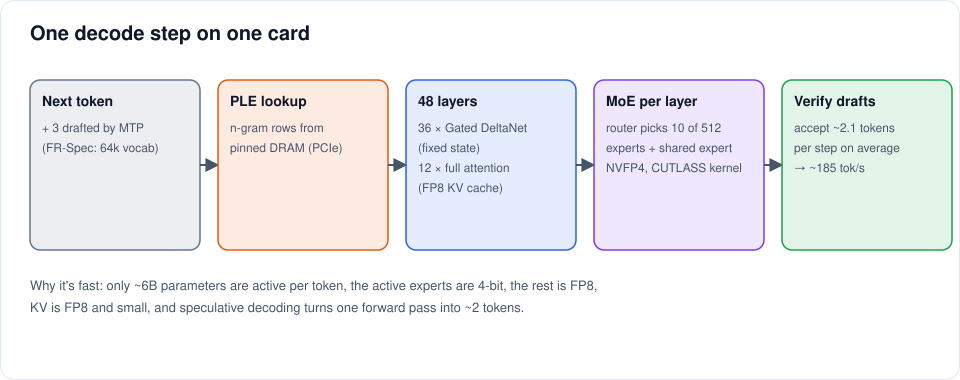
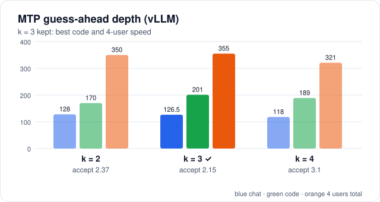
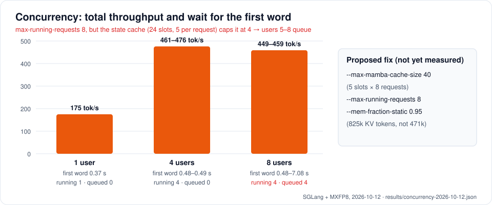

# Qwen3.8 Flash-Next (125B MoE) on one RTX PRO 6000: from 45 to 185 tokens/s

How we took a 125-billion-parameter mixture-of-experts model from **~45 tokens/s (llama.cpp)** to
**179–188 tokens/s for one user, 281–287 tokens/s for code, and 481 tokens/s total for four users**, on a
**single** 96 GB RTX PRO 6000 Blackwell card, with a 256k context and the whole model served from one GPU.

Everything is here: our NVFP4 conversion, the serving launchers, the patches, the benchmark scripts, the raw
results and the charts. Every number comes from a file in [`results/`](results/), and the charts are generated
from those files ([`tools/make_images.py`](tools/make_images.py)).


---

## Contents

1. [Results at a glance](#1-results-at-a-glance)
2. [Hardware and software](#2-hardware-and-software)
3. [The model in plain words](#3-the-model-in-plain-words)
4. [Where everything lives: VRAM and RAM](#4-where-everything-lives-vram-and-ram)
5. [The journey, step by step](#5-the-journey-step-by-step)
6. [Step 1: our own NVFP4 checkpoint](#6-step-1-our-own-nvfp4-checkpoint)
7. [What happens for every token](#7-what-happens-for-every-token)
8. [Speculative decoding (MTP + FR-Spec)](#8-speculative-decoding-mtp--fr-spec)
9. [Many users at once](#9-many-users-at-once)
10. [Quality checks](#10-quality-checks)
11. [Problems we hit (summary)](#11-problems-we-hit-summary)
12. [Reproduce it](#12-reproduce-it)
13. [How we measured](#13-how-we-measured)
14. [Limits and what's not done yet](#14-limits-and-whats-not-done-yet)
15. [FAQ](#15-faq)
16. [Repository layout](#16-repository-layout)
17. [Responsible use](#17-responsible-use)
18. [Credits and licence](#18-credits-and-licence)

---

## 1. Results at a glance

Same card, same model weights, warm engine, streaming requests, unique prompts. Output tokens per second.

| Step | Chat, 1 user | Code, 1 user | 4 users, total | Prefill | KV room (tokens) |
|---|---:|---:|---:|---:|---:|
| llama.cpp on Windows (GGUF Q5_K_M, 20 of 48 expert layers in RAM) | ~45 | ~45 | ~45 | ~380 | n/a |
| vLLM 0.31 + our NVFP4 (FlashInfer b12x, MTP k=3) | 127 | 195 | 353 | ~14,000 | 296,000 |
| SGLang Pennyroyal v2.5.3 + our NVFP4 (FP8 KV, MTP 3 + FR-Spec) | 150 | 215–240 | 395–432 | ~14,450 | 565,120 |
| **SGLang + online MXFP8 (production)** | **179–188** | **281–287** | **481** | ~13,500–14,500 | **825,472** |

Raw data: [`results/engine-steps.json`](results/engine-steps.json).

**Code is faster than chat** because code is more predictable, so the speculative "guess-ahead" step gets more of
its guesses right (see [section 8](#8-speculative-decoding-mtp--fr-spec)).

**Context:** 256k tokens per request (native). 512k via YaRN ×2 is possible but **not tested yet**
([docs/CONTEXT-512K.md](docs/CONTEXT-512K.md)).

**For comparison, reported by others (not measured by us):**

| Source | Setup | Reported |
|---|---|---|
| [SGLang Pennyroyal](https://github.com/jpezzulli/sglang-rtxpro6000) | 1× RTX PRO 6000, their NVFP4 | 171–207 tok/s, 1 user |
| [SirTificate/qwen38-flash-next-2x-rtx6000-sm120](https://github.com/SirTificate/qwen38-flash-next-2x-rtx6000-sm120) | 2× RTX PRO 6000, vLLM | 161 tok/s, 1 user; 1,056 tok/s total at 32 users |

Our single-user number sits inside Pennyroyal's reported range, which is what you'd expect: we use their engine,
with our own checkpoint and our own tuning.

---

## 2. Hardware and software

| Part | What we used | Does it matter? |
|---|---|---|
| GPU | 1× NVIDIA RTX PRO 6000 Blackwell Workstation Edition, 96 GB (97,887 MiB), SM120, 600 W limit | Everything below is tuned for SM120 |
| CPU | AMD Ryzen Threadripper 3990X, 64 cores | Hardly: decode is GPU-bound |
| RAM | 256 GB DDR4-2400 | **Yes**: a 102 GB lookup table lives in pinned RAM. 192 GB is the practical minimum |
| PCIe | Gen 4 x16 (our board's limit; the card supports Gen 5) | A little: rows of that table cross PCIe every token |
| OS | Ubuntu 26.04 LTS, kernel 7.0, NVIDIA driver 610.57 (open kernel modules) | 26.04's glibc needs a CUDA 13.3 toolkit for SGLang's JIT kernels |
| Disk | ~550 GB free during the build | BF16 source 360 GB + NVFP4 output 186 GB |

| Software | Version |
|---|---|
| SGLang Pennyroyal | `pennyroyal-v2.5.3-setup1` (commit `468e63a`), Python 3.12.13 |
| PyTorch | 2.13.0 (cu130) |
| FlashInfer (SGLang) | 0.6.17, SM120 CUTLASS fused MoE (**not** 0.7.0, see problems) |
| sglang-kernel | 0.4.6.post1 |
| CUDA toolkit for JIT | 13.3 (pip, separate folder) |
| vLLM path (fallback) | vLLM 0.31.0, FlashInfer 0.7.1rc4, b12x 1.5.0, cutlass-dsl 4.7.1, Python 3.14 |
| llama.cpp (starting point) | Windows 11 build, GGUF Q5_K_M |

---

## 3. The model in plain words

**Qwen3.8 Flash-Next** is a 125B-parameter mixture-of-experts (MoE) model. We used the
[Heretic](https://www.modelscope.cn/models/trohrbaugh/Qwen3.8-Flash-Next-heretic) variant (refusals removed; same
architecture and size, see [Responsible use](#17-responsible-use)).

| Feature | What it means | Why it matters for speed |
|---|---|---|
| **512 experts, 10 + 1 shared active** | Each layer has 512 small "expert" networks; a router picks 10 per token, plus one shared expert that always runs | Only **~6B parameters** are used per token, so it decodes like a small model, but all 125B must be stored somewhere fast |
| **48 layers: 36 Gated DeltaNet + 12 full attention** | Most layers use a "linear attention" with a fixed-size memory (state) instead of a growing KV cache | The KV cache is tiny: ~12 KB per token in FP8. 825k tokens fit in ~10 GB |
| **PLE n-gram table (102 GB)** | A huge lookup table indexed by the recent tokens; only a few rows are read per token | Can live in system RAM instead of VRAM: that's what makes one card possible |
| **MTP head** | A small extra layer trained to predict the next few tokens | Free speculative decoding: guess 3 tokens ahead, verify them in one pass |
| **Vision tower** | Image input | Kept in 16-bit, small |

The routed experts are ~90 % of the weights. Squeezing **only them** to 4-bit (NVFP4) gets the GPU part down to
~68 GB, and leaves room for everything else.

---

## 4. Where everything lives: VRAM and RAM



| What | Where | Size | Format |
|---|---|---:|---|
| Routed experts (gate/up/down, 48 layers × 512) | VRAM | ~68 GB | NVFP4 (FP4 values, FP8 scale per 16, FP32 per tensor) |
| Everything else: attention, shared experts, router, embeddings, `lm_head`, vision, MTP | VRAM | ~8–16 GB | BF16 on disk, converted to **MXFP8 at load** (`SGLANG_SM120_ONLINE_MXFP8=true`) |
| KV cache (12 full-attention layers only) | VRAM | ~10 GB at mem-fraction 0.95 (825,472 tokens); 5.74 GB at 0.90 (471,680 tokens) | FP8 E4M3 |
| Gated DeltaNet state cache | VRAM | 24 slots (`--max-mamba-cache-size 24`) | BF16 |
| CUDA graphs, workspaces, activations | VRAM | the rest | |
| **PLE n-gram table** | **pinned system RAM** | **102 GB** | BF16 (`--ple-offload-embedding`) |

Measured: 87–91 GB of the card's 97,887 MiB in use; the engine process holds ~99 GB of RAM. Details and the maths:
[docs/MEMORY.md](docs/MEMORY.md). Raw data: [`results/memory.json`](results/memory.json).

**Is the KV cache in RAM?** No. The KV cache and the state cache are on the GPU. Only the PLE lookup table is in
system RAM, and it is read a few rows at a time.

---

## 5. The journey, step by step

Full story with dates and what we tried: [docs/JOURNEY.md](docs/JOURNEY.md).

| # | Change | Chat tok/s | Why it helped |
|---|---|---:|---|
| 0 | llama.cpp on Windows, GGUF Q5_K_M | ~45 | Starting point. The model doesn't fit: 20 of 48 layers' experts ran from system RAM on the CPU |
| 1 | **Our own NVFP4 checkpoint** (experts only), Linux, **vLLM 0.31** | 127 | Whole model on the GPU (186 GB checkpoint, 102 GB of it the RAM table). Blackwell's native FP4 tensor cores. MTP k=3 |
| 2 | **SGLang Pennyroyal** (FlashInfer CUTLASS MoE, FP8 KV, MTP 3 + FR-Spec) | 150 | A faster FP4 MoE kernel on SM120 than vLLM's b12x "dynamic" mode; FR-Spec makes the MTP guesses cheaper; FP8 KV doubles token room |
| 3 | **Online MXFP8** for the remaining 16-bit layers | 179–188 | Attention, shared experts and `lm_head` are read every token; halving their bytes cuts the memory traffic per token |
| 4 | mem-fraction 0.90 → 0.95 | (same) | 471k → 825k tokens of KV room, for more and longer conversations at once |

Each step gave a different kind of win: **fit** (step 1), **better kernels** (step 2), **fewer bytes per token**
(step 3), **more room** (step 4).

---

## 6. Step 1: our own NVFP4 checkpoint



There was a reference NVFP4 release (RadixArk's) of the original model, but not of the Heretic weights. So we
built our own from the BF16 Heretic checkpoint:

1. **Download and verify** all 53 files (360 GB), with SHA-256 against the server's list. The downloader once
   said "done" with the 102 GB table missing. [`model/verify_all.py`](model/verify_all.py),
   [`model/fetch_shard.py`](model/fetch_shard.py).
2. **Borrow the calibration.** NVFP4 needs a per-expert activation scale (`input_scale`), normally found by
   running calibration data through the model. The Heretic edit is a small change to the weights, so we reused
   **RadixArk's calibrated scales** from the original model, read straight out of their safetensors with HTTP
   range requests (no 186 GB download). The error check in step 4 is what tells you this was safe. [`model/fetch_scales.py`](model/fetch_scales.py).
3. **Quantise only the routed experts** (gate, up, down): FP4 E2M1 values in groups of 16, one FP8 E4M3 scale per
   group, one FP32 scale per tensor. Gate and up share their per-tensor scale (the fused kernel needs it).
   Everything else stays BF16. [`model/convert.py`](model/convert.py), [`model/nvfp4.py`](model/nvfp4.py).
4. **Check against the reference**: same tensor names, shapes, dtypes and layout as RadixArk's release, and the
   same error. [`model/verify_layout.py`](model/verify_layout.py).

| Check | Ours | RadixArk reference |
|---|---:|---:|
| Relative error vs BF16 (sampled experts) | **0.00893** | 0.00892 |
| Size on disk | 186 GB | (same layout) |

Raw data: [`results/conversion.json`](results/conversion.json).

---

## 7. What happens for every token



For each new token the GPU has to read the weights that token touches: 10 routed experts + 1 shared expert per
layer × 48 layers, all the attention weights, and `lm_head`. Decode speed is mostly **how many bytes are read per
token** ÷ **memory bandwidth** (~1.8 TB/s on this card). That's why each step above is really about one of:

- **fewer bytes** (NVFP4 experts, MXFP8 for the rest, FP8 KV),
- **better kernels** (fused MoE that reads FP4 directly at full bandwidth),
- **more tokens per weight read** (speculative decoding: verify 4 tokens for the price of about one read),
- **sharing reads between users** (batching: four users' tokens use the same expert reads when they overlap).

The PLE table lookup is a few rows from pinned RAM over PCIe per token, small next to the GPU work.

---

## 8. Speculative decoding (MTP + FR-Spec)



The model has a built-in **MTP** (multi-token prediction) head that guesses the next tokens. The main model then
checks all the guesses in one pass and keeps the ones that match. More guesses ("depth") means more possible gain,
but also more wasted work when they're wrong.

**Depth on vLLM** ([`results/mtp-depth-vllm.json`](results/mtp-depth-vllm.json)):

| Depth k | Chat | Code | 4 users | Acceptance length |
|---:|---:|---:|---:|---:|
| 2 | 128 | 170 | 350 | 2.37 |
| **3 (kept)** | 126.5 | **201** | **355** | 2.15 |
| 4 | 118 | 189 | 321 | 3.10 |

k=3 is the best balance: chat is flat, code and multi-user are best. On SGLang we kept the same depth
(`--speculative-num-steps 3 --speculative-num-draft-tokens 4`) and added **FR-Spec**: the draft step only
considers the 64k most common tokens instead of all 248k, which makes each guess cheaper. Observed acceptance
length on SGLang: **2.06–2.13** tokens per step.

---

## 9. Many users at once



Measured 12 Oct 2026 on the production build ([`results/concurrency-2026-10-12.json`](results/concurrency-2026-10-12.json),
[`bench/concurrency.py`](bench/concurrency.py)): 500-word story prompts with a unique id each, 700 tokens out.

| Users | Total tok/s | Per user | Time to first token | Running / queued |
|---:|---:|---:|---:|---|
| 1 | 175 | 192 | 0.37 s | 1 / 0 |
| 4 | **461–476** | 124–142 | 0.48–0.49 s | 4 / 0 |
| 8 | 449–459 | 111–134 | 0.48–**7.08 s** | 4 / **4** |

(The first 4-user run after a restart gave 210 tok/s with a 7.9 s first token: one-time CUDA-graph warm-up,
excluded.)

**Why 8 users don't go faster than 4:** we had set `--max-running-requests 8`, but SGLang logged
*"max_running_requests is capped to 4 by the mamba state cache"*. Every running request needs **5 slots** of the
Gated DeltaNet state cache (with MTP and prefix caching), and `--max-mamba-cache-size 24` gives only 4 requests'
worth. Users 5–8 wait in the queue, so their first token takes up to 7 s.

**Proposed fix (not yet measured):** `--max-mamba-cache-size 40` → 8 running requests. Each slot costs VRAM, so
the KV room shrinks somewhat; we'll publish the measurement when it's done. Full flag notes:
[docs/TUNING.md](docs/TUNING.md).

---

## 10. Quality checks

Spot checks on the production build ([`results/quality-2026-10-08.json`](results/quality-2026-10-08.json),
[`bench/eval_models.py`](bench/eval_models.py)). These are sanity checks, **not** a benchmark suite.

| Check | Result |
|---|---|
| Model writes a module **and its own tests**; we run the tests | 10/10 and 9/9 passed |
| Long answer (7-day plan with a budget table) | 2,934 tokens in 13.5 s, no repetition |
| Vision (describe a photo) | correct |
| Borderline prompts (uncensored variant) | 0 of 5 refused |
| Two-step tool calls, thinking on | **40/40** |

### Tool calls

The two-step test: the model must call a tool, receive the result, and then **use** that result in its answer.

| Setting | Answer used the tool result |
|---|---|
| presence penalty 1.5, thinking off | 10/20 (vLLM), 15/40 (SGLang) |
| presence penalty 0–1.0, thinking off | ~26–27/40 |
| **thinking on for requests that carry tools** | **40/40 on both engines** |

So: keep thinking **off** for plain chat (first token in ~0.3 s) and turn it **on** for tool-using requests
(`"chat_template_kwargs": {"enable_thinking": true}`), which costs ~0.5 s per tool round.
[`bench/tooltest.py`](bench/tooltest.py).

---

## 11. Problems we hit (summary)

The full list with error messages: [docs/PROBLEMS.md](docs/PROBLEMS.md). The ones most likely to bite you:

| Problem | Fix |
|---|---|
| Downloader said "done", 102 GB shard missing | Verify every file's SHA-256 ([`model/verify_all.py`](model/verify_all.py)) |
| FlashInfer **0.7.0** crashes with 512 experts | Use 0.6.17 (SGLang) or 0.7.1rc4 (vLLM). Never 0.7.0 |
| vLLM: OOM at warm-up, one b12x workspace per layer (+14 GB) | [`serving/vllm/patch_b12x.py`](serving/vllm/patch_b12x.py): all layers share one |
| vLLM: OOM, b12x "static" mode pads experts 640 → 768 | [`serving/vllm/patch_flashinfer_force_backend.py`](serving/vllm/patch_flashinfer_force_backend.py) + `B12X_FORCE_BACKEND=dynamic` |
| vLLM: MTP layer has BF16 experts, b12x refuses | Separate MoE backend for the draft: `"moe_backend": "triton"` |
| SGLang: unknown layer type `qwen_sparse_attention` | Model view with a renamed `config.json` ([`model/sglang-view-config.json`](model/sglang-view-config.json)) |
| SGLang: FR-Spec rejects the tokenizer checksum | Proved the vocab identical, used the byte-identical `tokenizer.json` |
| SGLang JIT fails on Ubuntu 26.04 (`rsqrt` glibc vs CUDA 13.0) | Separate CUDA 13.3 pip toolkit |
| 8 users run as 4 | State cache cap, see [section 9](#9-many-users-at-once) |
| Benchmark shows 72,000 tok/s | Prefix cache: the same prompt sent twice. Use unique prompts |
| Engine restarted overnight by itself | Ubuntu's unattended-upgrades + `needrestart`. See [docs/PROBLEMS.md](docs/PROBLEMS.md#keeping-it-up) |

---

## 12. Reproduce it

Full guide with every command: **[docs/BUILD.md](docs/BUILD.md)**. Short version:

```sh
# 1. Source weights (BF16, 360 GB) + verify every file
modelscope download --model trohrbaugh/Qwen3.8-Flash-Next-heretic --local_dir /srv/ai/models/flash-next-heretic-bf16
python model/verify_all.py

# 2. NVFP4 (experts only), reusing RadixArk's calibrated activation scales
python model/fetch_scales.py && python model/convert.py && python model/verify_layout.py

# 3. SGLang Pennyroyal v2.5.3 (+ CUDA 13.3 pip toolkit on Ubuntu 26.04), model view, kernel prebuild
serving/sglang/prebuild_moe.sh

# 4. Serve (OpenAI-compatible on 127.0.0.1:8080), online MXFP8 on
serving/sglang/serve-sglang.sh true

# 5. Measure
python bench/bench.py http://127.0.0.1:8080 qwen3.8-flash-next-uncensored
python bench/concurrency.py
```

Then call it like any OpenAI-compatible server:

```sh
curl http://127.0.0.1:8080/v1/chat/completions -H "Content-Type: application/json" -d '{
  "model": "qwen3.8-flash-next-uncensored",
  "messages": [{"role": "user", "content": "Explain NVFP4 in two sentences."}],
  "stream": true
}'
```

Paths in the scripts are our machine's (`/srv/ai/...`); edit the variables at the top of each script.

---

## 13. How we measured

- **Unique prompts every time.** SGLang and vLLM cache prompt prefixes; a repeated prompt skips prefill and
  inflates numbers (we once saw "72,000 tok/s").
- **Warm engine.** The first request at each new batch size triggers CUDA-graph warm-up; we excluded it and say so
  in the raw files.
- **Streaming**, tokens counted from the server's usage report; tok/s = output tokens ÷ time from first to last
  token (per user) or ÷ wall time (total).
- **Chat** = a story/explanation prompt; **code** = a "write a Python module" prompt. Both in
  [`bench/bench.py`](bench/bench.py).
- **Power limit 600 W** (the card's default) unless stated.
- **Ranges** (e.g. 179–188) are the spread over repeated runs on different days.
- **"Measured" vs "reported by others"** are always kept apart in [`results/`](results/).

---

## 14. Limits and what's not done yet

| Item | Status |
|---|---|
| 8 running requests (`--max-mamba-cache-size 40`) | proposed, not measured |
| 512k context (YaRN ×2) | possible, not tested: [docs/CONTEXT-512K.md](docs/CONTEXT-512K.md) |
| Power curve (tok/s per watt at 350–600 W) | not measured properly yet; a rough observation suggested 450 W keeps ~90 % of the speed |
| Standard benchmarks (GSM8K, HumanEval+, …) on our NVFP4 vs the reference | not done; only the spot checks above |
| Our NVFP4 weights | **not published** here; this repo has the code to build them |
| Other GPUs | only tested on the RTX PRO 6000 (SM120); the kernels and flags are SM120-specific |

---

## 15. FAQ

Short answers; more in [docs/FAQ.md](docs/FAQ.md).

- **Why not just use the reference NVFP4?** It's of the original model; we wanted the Heretic weights. If you want
  the original model, use the reference release and skip step 1.
- **Is the KV cache in RAM?** No, it's on the GPU. Only the 102 GB PLE lookup table is in RAM.
- **Why FP8 KV and not BF16?** BF16 KV would halve the token room (825k → ~412k). FP8 KV is the upstream default here;
  we haven't compared quality side by side.
- **1M context?** No: 825k tokens of KV room is shared by all requests, and stretching the position encoding ×4 is
  beyond what the model authors validated.
- **Would a second card help?** For many users at once, yes (others report 1,056 tok/s at 32 users on two
  cards). For one user, not much: one user is already limited by the memory reads of one card.
- **Why is SGLang faster than vLLM here?** On SM120 its FlashInfer CUTLASS FP4 MoE kernel runs without the padding
  and per-layer workspaces vLLM's b12x path needed, plus FR-Spec and online MXFP8.

---

## 16. Repository layout

```
README.md                 this page
docs/
  BUILD.md                every command, in order
  JOURNEY.md              llama.cpp → vLLM → SGLang → SGLang + MXFP8, what each step changed
  RESULTS.md              all numbers and where they come from
  MEMORY.md               VRAM and RAM map, KV maths
  TUNING.md               every serving flag and its effect
  PROBLEMS.md             every problem and its fix
  CONTEXT-512K.md         how to try 512k context (untested)
  FAQ.md
images/                   charts (generated by tools/make_images.py from results/)
model/                    download checks, NVFP4 conversion, verification, SGLang view config
serving/sglang/           production launcher + MoE kernel prebuild
serving/vllm/             earlier launcher + the two FlashInfer/b12x patches + prebuild
bench/                    speed, concurrency, tool-call, long-context and quality scripts
results/                  raw JSON for every number in this README
tools/gpuctl.py           optional fan/power-cap daemon (NVML) with a thermal safety override
tools/make_images.py      regenerates the charts
deploy/systemd/           service files for the engines and gpuctl
```

Regenerate the charts after changing a result: `python tools/make_images.py`.

---

## 17. Responsible use

The weights we serve are an **uncensored** ("Heretic", refusal-removed) variant. That was a deliberate choice for
our own internal use; it changes nothing about the speed work in this repo, which applies equally to the original
Qwen3.8 Flash-Next. If you deploy an uncensored model, you are responsible for what it is used for: keep it away
from untrusted users, add your own filtering where needed, and follow the licences of the original model and the
variant. This repository contains **no model weights**.

---

## 18. Credits and licence

This work stands on other people's: [CREDITS.md](CREDITS.md) lists every project and its licence. In short: the
Qwen team (model), trohrbaugh (Heretic variant), RadixArk (reference NVFP4 and calibration scales), jpezzulli
(SGLang Pennyroyal), the SGLang, vLLM, FlashInfer, b12x and NVIDIA ModelOpt projects, and llama.cpp.

Our code and docs: **Apache-2.0** ([LICENSE](LICENSE)). Model weights are under their own licences.
