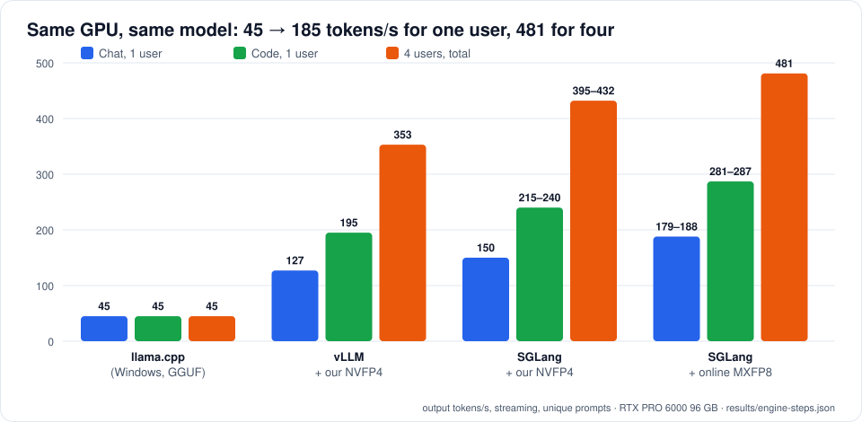

# The journey: 45 → 185 tokens/s

Same card (RTX PRO 6000 Blackwell, 96 GB), same model (Qwen3.8 Flash-Next, Heretic weights), October 2026.
Numbers: [`results/engine-steps.json`](../results/engine-steps.json).

## Step 0: llama.cpp on Windows (~45 tok/s), 6 Oct

GGUF Q5_K_M is ~5.5 bits per weight for everything, which is too big for 96 GB together with the PLE table. llama.cpp
put the experts of 28 of the 48 layers on the GPU and ran the other 20 on the CPU from system RAM. Every token
waited for the CPU part: ~45–48 tok/s for chat and code alike, ~380 tok/s prefill, and no gain from more users
(they share the same ~45).

**Lesson:** for an MoE this size, the question isn't "which engine" but "does it fit on the card". It didn't.

## Step 1: our NVFP4 + Linux + vLLM 0.31 (127 tok/s), 7 Oct

- **Format:** NVFP4 for the routed experts only (~4.5 bits per weight including scales); everything else BF16.
  The GPU part became ~84 GB including the 16-bit layers; the 102 GB PLE table moved to pinned RAM. Now the whole
  model runs on the GPU. Details: [README §6](../README.md#6-step-1-our-own-nvfp4-checkpoint).
- **Why our own:** the reference NVFP4 (RadixArk) was of the original model; we wanted the Heretic weights. We reused
  their calibration scales and matched their error (0.00893 vs 0.00892).
- **Engine:** vLLM 0.31 with FlashInfer's b12x FP4 MoE for SM120 and MTP speculative decoding (k=3, chosen by
  measurement: [`results/mtp-depth-vllm.json`](../results/mtp-depth-vllm.json)).
- **Cost:** eleven separate problems before it ran ([PROBLEMS.md](PROBLEMS.md#vllm-stage)). The two that shaped
  the speed: b12x's "static" mode padded every expert 640 → 768 wide and kept padded copies (out of memory), so we
  forced "dynamic" mode, which is slower.
- **Result:** 127 chat / 195 code / 353 for 4 users; prefill ~14,000 tok/s; 296k tokens of KV room.

## Step 2: SGLang Pennyroyal (150 tok/s), 8 Oct

[Pennyroyal](https://github.com/jpezzulli/sglang-rtxpro6000) is an SGLang build tuned for exactly this card and
model family. What changed:

- **MoE kernel:** FlashInfer 0.6.17's SM120 CUTLASS fused MoE reads our NVFP4 experts with no padding and no
  per-layer workspaces.
- **FP8 KV cache** (`fp8_e4m3`): half the bytes per token of BF16; KV room 296k → 565k tokens.
- **NEXTN MTP 3 + FR-Spec:** same guess depth as before, but the draft head only scores the 64k most common
  tokens, so each guess costs less.
- **Gated DeltaNet kernels** from FlashInfer for prefill and decode, and prefix caching for those layers
  (`--mamba-radix-cache-strategy extra_buffer`).
- **Three small fixes to load our checkpoint** (renamed layer type, tokenizer checksum, CUDA 13.3 for the JIT):
  [PROBLEMS.md](PROBLEMS.md#sglang-stage).

Result: 150 chat / 215–240 code / 395–432 for 4 users.

## Step 3: online MXFP8 (179–188 tok/s), 8 Oct

With the experts at 4-bit, the 16-bit layers (attention projections, shared experts, `lm_head`, MTP head) became a
big share of the bytes read per token. Pennyroyal can convert them to **MXFP8** while loading
(`SGLANG_SM120_ONLINE_MXFP8=true`): FP8 values with a shared scale per block of 32, no new checkpoint needed.
Half the bytes for those layers → +20–25 % speed, and more free VRAM.

Result: **179–188 chat / 281–287 code / 481 for 4 users**. We saw no quality change in our spot checks
([RESULTS.md](RESULTS.md#quality)).

## Step 4: more room (12 Oct)

`--mem-fraction-static` 0.90 → 0.95: KV room 471,680 → 825,472 tokens. No speed change; more and longer
conversations fit at once. We also found the concurrency cap (4 running requests because of the state cache):
[TUNING.md](TUNING.md#concurrency).

## What we tried and dropped

| Tried | Why dropped |
|---|---|
| llama.cpp with more layers on the GPU | Doesn't fit at Q5; lower quants lose quality, and the CPU part still sets the pace |
| vLLM b12x "static" mode | Pads 640 → 768 and caches padded copies: out of memory on one card |
| FlashInfer 0.7.0 | Crashes with 512 experts (CUDA-graph padding rows read as expert id −1) |
| MTP depth 4 | Higher acceptance length but more wasted work: slower than 3 for chat, code and 4 users |
| Calibrating NVFP4 ourselves | Reusing the reference scales gave the same error; nothing to gain |
| mem-fraction 0.90 | Same speed as 0.95, 43 % less KV room |
